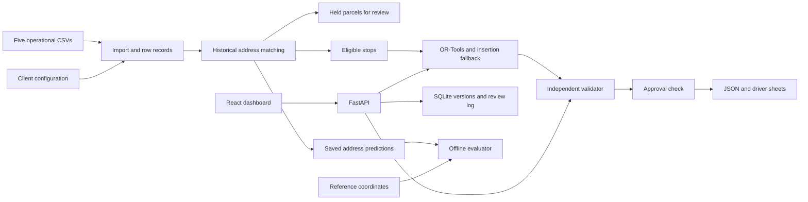

# Architecture

FastAPI reads the source files, resolves addresses, plans routes and handles manager actions. React displays the results. SQLite saves each plan version and review event. A separate command evaluates saved address predictions against the reference sample. The API serves that report without reading the reference coordinates.

`ingestion.py` keeps raw values beside normalized values and records problems for each row. `addresses.py` matches historical locations or holds an address for review. `routing.py` proposes routes. `validation.py` checks them against the imported parcels, fleet and coordinates. It imports no routing code, but shares geometry, time and configuration helpers from `core.py`.

`metrics.py` reports planned deliveries, actual completions and cost scenarios separately. `api.py` handles requests and exports. `storage.py` appends snapshots to SQLite. An edit creates a new version; it never overwrites the earlier one.

Planning runs within the HTTP request. The solver has a five-second limit, followed by insertion repair. Import, address matching and repair add to the total request time. Before dispatch, an absence or breakdown holds the affected work and preserves other route sequences. Dispatch freezes the plan. Recovery then requires manual coordination because the app has no live driver location, parcel handover records or proof of delivery.

Each version saves its input and configuration, except the large history and area tables. Loads filter by tenant and hub to prevent accidental mixing. Production still needs authentication, authorization and separate source directories for each client. Run the prototype on loopback. Use the example client configuration with its own data.

One process lock serializes SQLite writes. Retrying an edit can create another version, and simultaneous operators can overwrite each other's intended changes. Production needs request deduplication and checks that reject edits based on an outdated version.

Errors return HTTP 4xx messages for rejected operations. Uvicorn logs request status and runtime exceptions. Saved plans include solver choice, fallback reason, duration, validation findings and change summaries. The app calls no external geocoder or AI service. OpenStreetMap receives tile requests that reveal the viewed bounds; it receives no address text. Route lines and stop lists remain available if tiles fail.
